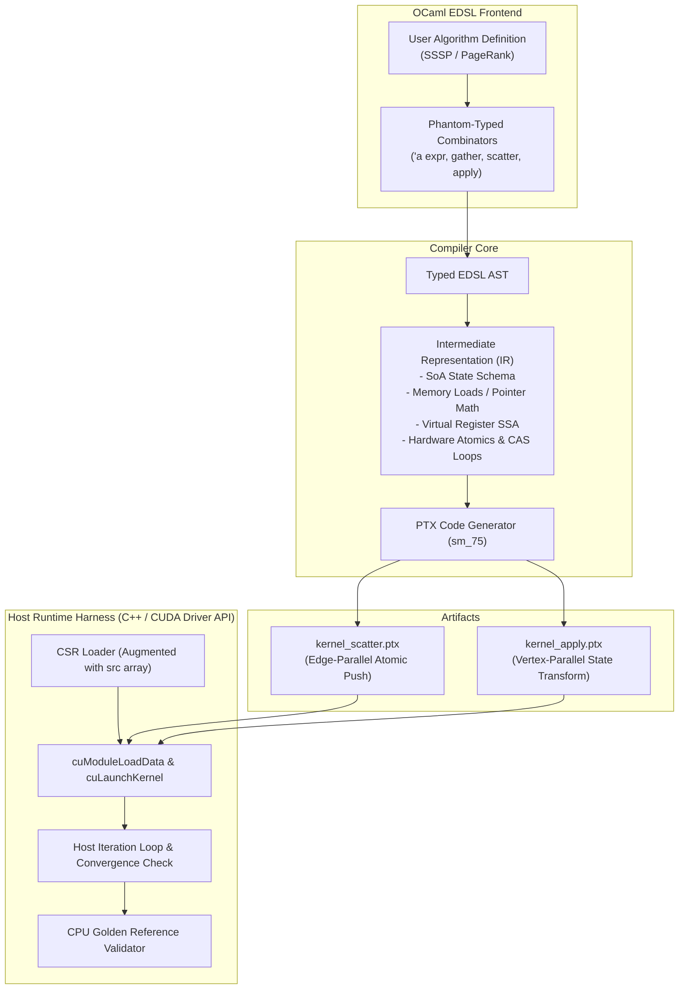

# GAS-DSL Abstract

---

### 1. Summary

**GAS-DSL** is a statically-typed domain-specific language embedded in OCaml designed to compile Gather-Apply-Scatter (GAS) graph processing algorithms directly into standalone NVIDIA PTX (Parallel Thread Execution) assembly. Targeting static graphs stored in an augmented Compressed Sparse Row (CSR) format, the compiler translates high-level graph specifications into decoupled, high-performance GPU kernels for iterative analytics such as **Single-Source Shortest Path (SSSP)** and **PageRank**, without requiring complex host runtimes or dynamic GPU memory management.

---

### 2. Architecture Design

---

### 3. Design Decisions

| Subsystem                | Decision                                         | Rationale                                                                                                                                                                                                                                                                                    |
|:-------------------------|:-------------------------------------------------|:---------------------------------------------------------------------------------------------------------------------------------------------------------------------------------------------------------------------------------------------------------------------------------------------|
| **Execution Model**      | **Edge-Parallel Kernel + Vertex-Parallel Apply** | Decomposes execution into an edge-parallel Scatter kernel (1 thread per edge) for atomic propagation, and a vertex-parallel Apply kernel for post-reduction state updates (e.g., PageRank damping). This avoids load-imbalance on power-law graphs and eliminates in-kernel binary searches. |
| **Graph Representation** | **Augmented CSR (COO-style edge source array)**  | Augments standard CSR arrays (`row_offsets`, `dst_indices`, `weights`) with a precomputed `src_indices` array. Edge threads retrieve source and target vertices in $O(1)$ time without divergent control flow.                                                                               |
| **Memory Layout**        | **Structure-of-Arrays (SoA)**                    | Vertex and edge properties (`dist`, `rank`, `out_deg`) reside in independent global memory arrays passed as 64-bit pointers (`.param .u64`), guaranteeing coalesced memory transactions.                                                                                                     |
| **EDSL Typing**          | **Phantom Types (`'a expr`) over IR ADT**        | Uses smart constructors tagged with phantom types to enforce type safety in OCaml at compile time while lowering to an untyped, easily optimizable linear IR for code generation.                                                                                                            |
| **Verification**         | **Minimal C++ CUDA Driver Harness**              | A lightweight standalone test harness using the CUDA Driver API (`cuda.h`, `cuModuleLoadData`, `cuLaunchKernel`) loads the emitted `.ptx` files, manages host-device data transfers, and validates results against a sequential CPU reference.                                               |
