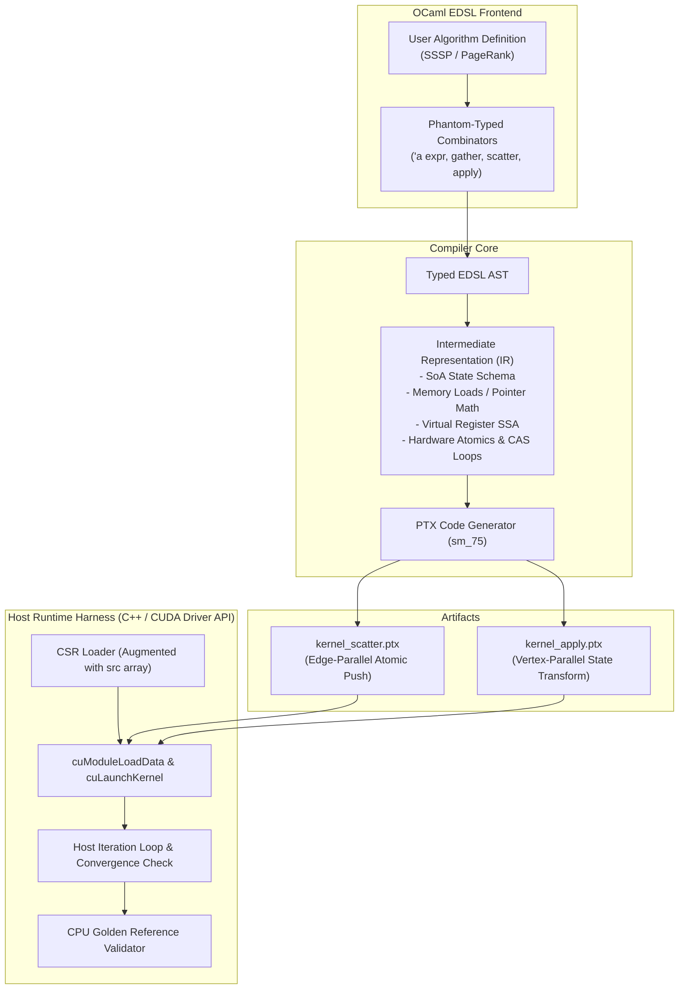
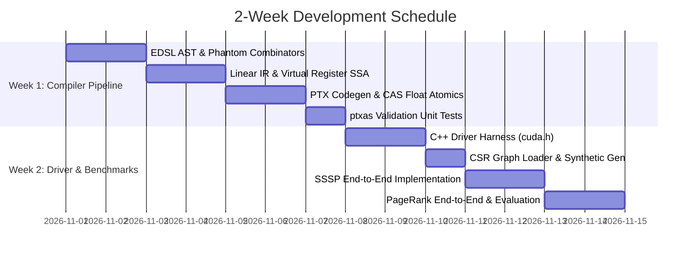

 Gather-Apply-Scatter EDSL for GPU Graph Analytics
## Architecture Specification & 2-Week Implementation Plan

---

### 1. Executive Summary

**GAS-DSL** is a statically-typed domain-specific language embedded in OCaml designed to compile Gather-Apply-Scatter (GAS) graph processing kernels directly into standalone NVIDIA PTX (Parallel Thread Execution) assembly. It targets static graphs stored in an augmented Compressed Sparse Row (CSR) format and generates decoupled, high-performance GPU kernels for iterative graph algorithms including **Single-Source Shortest Path (SSSP)** and **PageRank**.

---

### 2. System Architecture



---

### 3. Key Design Decisions

| Subsystem | Decision | Rationale |
| :--- | :--- | :--- |
| **Execution Model** | **Edge-Parallel Kernel + Vertex-Parallel Apply** | 1 thread per edge avoids severe load imbalance on power-law graphs and eliminates in-kernel binary searches. |
| **Graph Representation** | **Augmented CSR (COO-style edge source array)** | Graph contains `row_offsets` ($|V|+1$), `src_indices` ($|E|$), `dst_indices` ($|E|$), and `weights` ($|E|$). Edge threads index source and target vertices in $O(1)$ without divergent branch loops. |
| **Memory Layout** | **Structure-of-Arrays (SoA)** | Vertex/edge attributes (e.g., `dist`, `rank`, `out_deg`) are passed as distinct 64-bit pointers (`.param .u64`), guaranteeing coalesced global memory access. |
| **Atomic Reductions** | **Native Int/Float Add + Float CAS Loop** | PTX hardware natively supports `atom.global.min.u32/s32` and `atom.global.add.f32`. Float `min`/`max` (e.g. SSSP with float distances) lowers to a PTX Compare-and-Swap loop (`atom.global.cas.b32`). |
| **EDSL Typing** | **Phantom Types (`'a expr`) over IR ADT** | Provides OCaml compile-time type safety for user math expressions while maintaining a flat, easily optimizable AST for backend lowering. |
| **Register Model** | **Virtual Register SSA** | Monotonically allocated registers (`%r<N>`, `%f<N>`, `%p<N>`). Register allocation and physical scheduling are delegated to NVIDIA's optimizing `ptxas`. |
| **Verification** | **Minimal C++ CUDA Driver Harness** | Standalone C++ harness using `cuda.h` (`cuModuleLoadData`, `cuLaunchKernel`) validates generated `.ptx` files against a CPU reference. |

---

### 4. Mathematical Model & Algorithm Mapping

#### 4.1 Single-Source Shortest Path (SSSP)
* **Vertex State:** `dist : f32` (initialized to $0.0$ for source, $\infty$ for others).
* **Edge State:** `weight : f32`.
* **Scatter Phase (Edge-Parallel):**
  $$\text{update}(e) = \text{dist}[u] + \text{weight}[e]$$
  $$\text{dist}[v] \leftarrow \min_{\text{atomic}}(\text{dist}[v], \text{update}(e))$$
* **Convergence:** Run for at most $|V|-1$ iterations, or until a host-side dirty flag detects no vertex updates.

#### 4.2 PageRank
* **Vertex State:** `rank : f32`, `next_rank : f32`, `out_deg : u32`.
* **Hyperparameters:** Damping factor $d = 0.85$, base weight $\frac{1 - d}{|V|}$.
* **Scatter Phase (Edge-Parallel):**
  $$\text{contrib}(e) = \frac{\text{rank}[u]}{\text{out\_deg}[u]}$$
  $$\text{next\_rank}[v] \leftarrow \text{next\_rank}[v] +_{\text{atomic}} \text{contrib}(e)$$
* **Apply Phase (Vertex-Parallel):**
  $$\text{rank}[v] = \frac{1 - d}{|V|} + d \times \text{next\_rank}[v]$$
  $$\text{next\_rank}[v] = 0.0$$

---

### 5. Detailed Component Specifications

#### 5.1 OCaml EDSL & IR (`lib/`)

```ocaml
(* Core Primitive Types *)
type prim_type = F32 | U32 | I32 | B8

(* Typed Field Descriptors *)
type 'a field = { name : string; ty : prim_type }

(* Phantom-typed AST Expressions *)
type 'a expr =
  | ConstFloat : float -> float expr
  | ConstInt   : int -> int expr
  | FieldRef   : 'a field * [ `Src | `Dst | `Edge | `Self ] -> 'a expr
  | Add        : 'a expr * 'a expr -> 'a expr
  | Sub        : 'a expr * 'a expr -> 'a expr
  | Mul        : 'a expr * 'a expr -> 'a expr
  | Div        : 'a expr * 'a expr -> 'a expr
  | Min        : 'a expr * 'a expr -> 'a expr

(* Reduction Operators *)
type reduction_op = OpMin | OpMax | OpSum

(* Kernel Stage Definitions *)
type scatter_spec = {
  gather_expr : float expr;
  target_field : float field;
  op : reduction_op;
}

type apply_spec = {
  apply_expr : float expr;
  dest_field : float field;
}
```

#### 5.2 PTX Code Generation Backend

1. **Header & Target Definition:** Emits `.version 7.0`, `.target sm_75`, `.address_size 64`.
2. **Kernel Parameters:** Emits `.param .u64` for all graph buffers (`src_arr`, `dst_arr`, `weights`, state arrays) and `.param .u32 num_edges`.
3. **Thread Guarding:**
   ```ptx
   mov.u32 %tid, %ctaid.x;
   mul.lo.u32 %tid, %tid, %ntid.x;
   add.u32 %tid, %tid, %tid.x;
   setp.ge.u32 %p0, %tid, %num_items;
   @%p0 bra EXIT;
   ```
4. **Pointer Offset Arithmetic:** Converts 32-bit indices to 64-bit byte offsets (`mul.wide.u32`, `add.u64`).
5. **CAS Loop for Float Min:**
   ```ptx
   $CAS_LOOP:
   ld.global.f32 %cur_val, [%addr];
   setp.ge.f32   %p_skip, %cur_val, %new_val;
   @!%p_skip bra $CAS_END;
   atom.global.cas.b32 %old_bits, [%addr], %cur_bits, %new_bits;
   setp.eq.b32   %p_success, %old_bits, %cur_bits;
   @!%p_success bra $CAS_LOOP;
   $CAS_END:
   ```

---

### 6. Two-Week Execution Roadmap



* **Week 1 Deliverables:**
  * OCaml library compiling user DSL specifications to valid `.ptx` files.
  * Unit test suite verifying syntax and compilation with `/usr/local/cuda-13.3/bin/ptxas -arch=sm_75`.
* **Week 2 Deliverables:**
  * C++ driver (`cuda_driver_runner.cpp`) utilizing CUDA Driver API.
  * Verified SSSP and PageRank runs against CPU golden models on test graphs.
  * Performance and correctness summary report.
